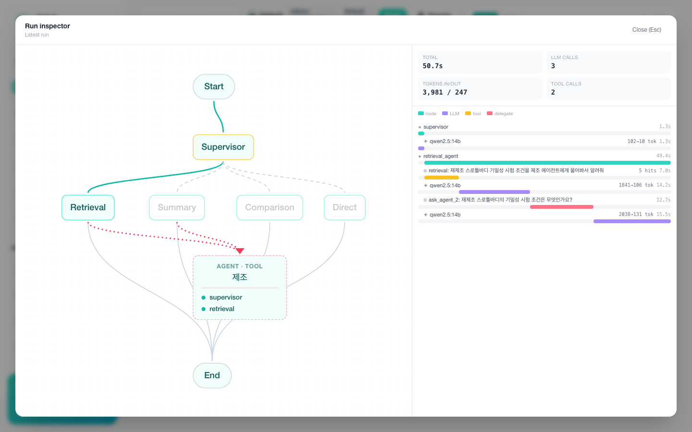
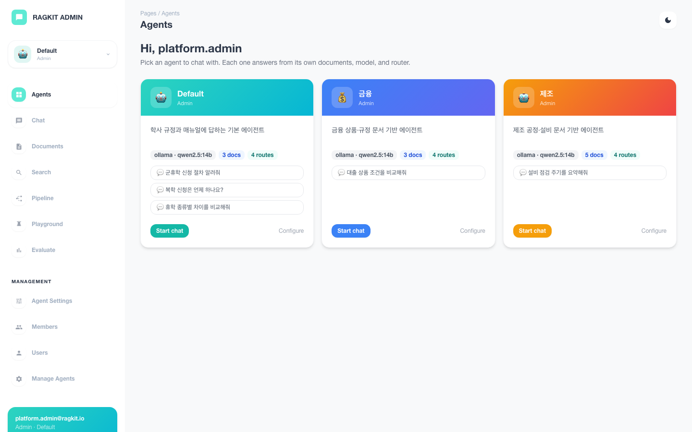
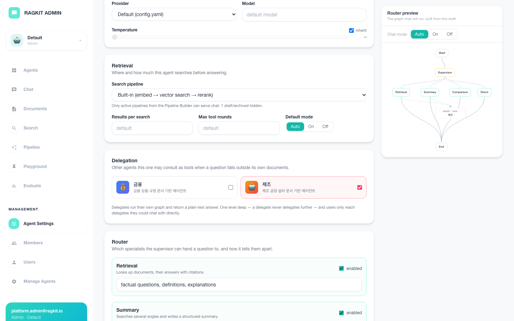
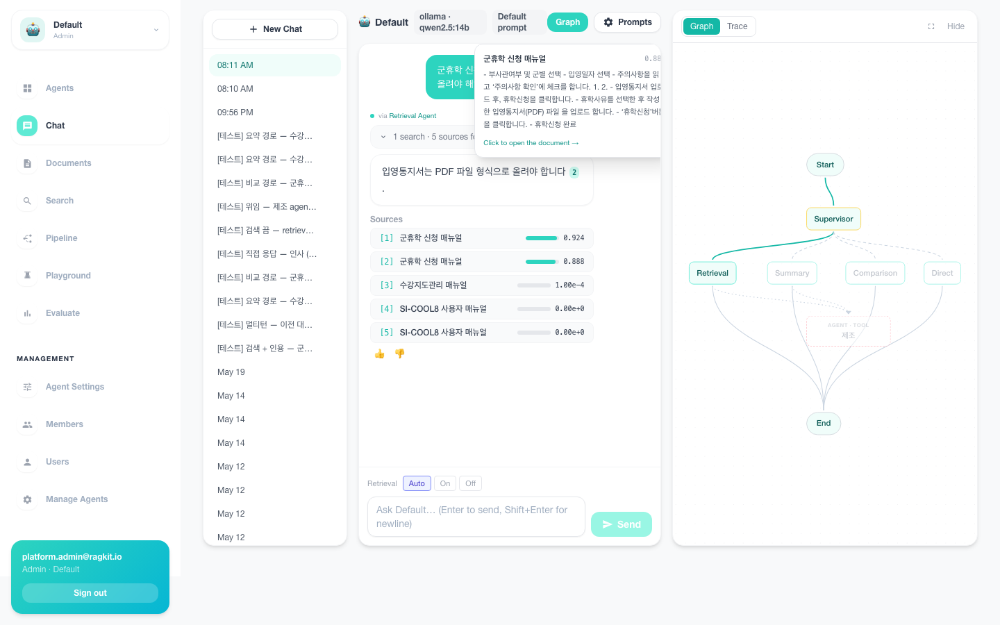
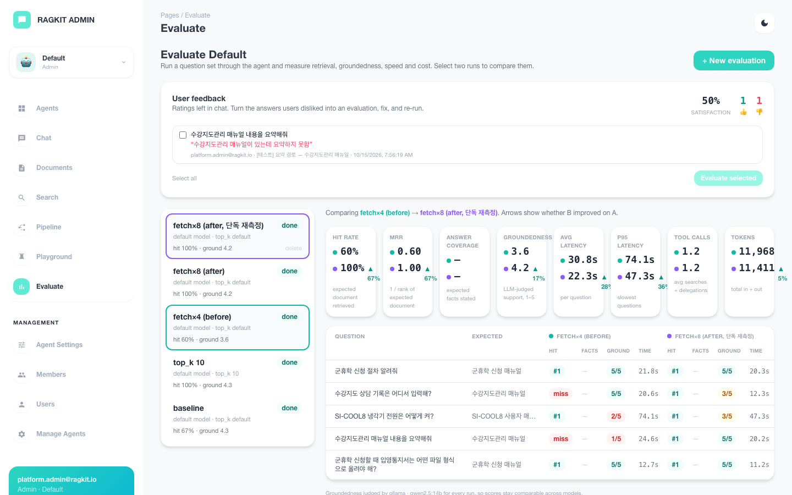
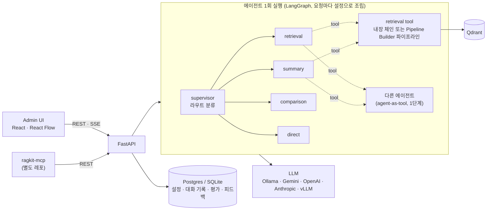

# ragkit

문서 기반 **멀티 에이전트 RAG 플랫폼**입니다. 에이전트를 만들어 각자의 문서·모델·라우터를 설정하고, 답변이 만들어지는 과정을 실시간 그래프와 trace로 확인하고, 사용자 피드백을 평가 세트로 바꿔 설정 변경의 효과를 수치로 검증합니다.



> 사용자 가이드: [docs/user-guide.ko.md](docs/user-guide.ko.md) · 배포: [deploy/README.md](deploy/README.md)

## 무엇을 하나

| | |
|---|---|
| **Agents** — 첫 화면에서 대화할 에이전트를 고릅니다. 카드에는 실제로 돌아가는 모델, 문서 수, 시작 질문이 보입니다. |  |
| **Agent Settings** — 에이전트별로 LLM provider·모델, 검색 파이프라인, 라우터(어떤 전문 에이전트로 보낼지), 위임 대상을 UI로 설정합니다. 오른쪽 미리보기는 저장 전 설정으로 실제 그래프를 그립니다. |  |
| **Chat** — 답변의 `[1]`에 마우스를 올리면 근거 구절이, 클릭하면 문서가 열립니다. 옆 패널에서 그래프가 실행 위치를 따라 켜지고, 답변마다 👍/👎를 남깁니다. |  |
| **Evaluate** — 질문 세트를 설정 A/B로 돌려 검색 적중률, 답변 핵심어 포함률, 근거성(LLM 채점), 지연, 토큰을 비교합니다. 👎 받은 질문을 그대로 평가 세트로 가져옵니다. |  |

## 아키텍처



채팅은 SSE로 스트리밍되며, 토큰 외에 그래프 모양(`graph`), 노드 진입·이탈(`node_state`), 위임 에이전트 내부 진행(`delegate_state`), 실행 구간(`span`)을 함께 보냅니다. UI의 그래프와 trace는 이 이벤트만으로 그려집니다.

| 경로 | 내용 |
|---|---|
| `server/app/agent/` | 그래프 조립(`graph.py`), 위임(`delegation.py`), trace(`trace.py`), 텍스트 tool 호출 복구(`recovery.py`) |
| `server/app/eval/` | 평가 실행기 — 채팅과 같은 코드 경로로 질문을 돌리고 채점 |
| `server/app/llm/` | provider별 모델 생성, Gemini 어댑터 |
| `admin/src/` | 관리자 SPA |
| `deploy/` | 전체 스택 compose, GPU 오버레이, AWS user-data |

## 설계 결정

**에이전트 간 통신은 "에이전트를 tool로 호출"로 한정했습니다.** 자유 대화형 멀티 에이전트는 종료 조건이 없으면 비용이 발산합니다. 호출 → 반환 구조라 종료가 보장되고, 위임은 한 단계까지만 허용해 순환을 막습니다. 사용자가 직접 접근할 수 없는 에이전트로는 위임되지 않습니다.

**provider 경계에서는 평문만 넘깁니다.** Gemini 3는 tool 호출마다 `thought_signature`를 요구하고, 이 메타데이터는 OpenAI 형식으로 왕복되지 않아 다음 턴이 400으로 실패했습니다. 에이전트마다 provider가 다를 수 있으므로 위임 결과는 메시지 객체가 아니라 답변 텍스트로만 돌려줍니다.

**첫 검색은 모델에 맡기지 않습니다.** 로컬 소형 모델(qwen2.5:14b)은 "검색하겠습니다"라고만 하고 멈추거나, tool 호출을 `{"name": "retrieval", ...}` 같은 텍스트로 출력해 대화가 끊겼습니다. retrieval·summary 에이전트는 서버가 먼저 검색한 결과를 받은 상태에서 시작하고, 텍스트로 새어 나온 tool 호출은 post-model hook이 실제 호출로 복구합니다.

**설정은 에이전트별로 DB에, 비밀은 환경변수에 둡니다.** API 키는 provider별 환경변수(`GOOGLE_API_KEY` 등)에서만 읽고, DB에는 "어느 provider·모델을 쓸지"만 저장합니다.

**평가 지표의 사각지대를 지표로 메웠습니다.** 문서 단위 적중률은 "맞는 문서의 엉뚱한 청크"도 적중으로 세고, 근거성 judge는 검색된 구절만 보기 때문에 "문서에 없다"는 틀린 답에 5점을 줬습니다. 그래서 문항마다 답변에 들어가야 할 핵심어를 지정하는 **답변 핵심어 포함률**을 추가했습니다. judge는 항상 기본 모델로 고정해, 다른 모델끼리 비교해도 같은 기준으로 채점됩니다.

**같은 코드가 SQLite와 Postgres 양쪽에서 돕니다.** 로컬 개발은 설치 없이 SQLite로, 배포 스택은 Postgres로 돕니다. 대화 기록 저장소도 DB URL에 따라 고르고, CI가 매 커밋마다 Postgres에서 마이그레이션을 upgrade → downgrade → upgrade로 검증합니다.

## 측정으로 확인한 것

모든 수치는 이 저장소의 평가 기능과 로컬 스택(qwen2.5:14b, Ollama)으로 측정했습니다.

| 변경 | 결과 |
|---|---|
| 리랭커 후보 수 ×4 → ×8 (`fetch_k_multiplier`) | 문서 적중률 학사 60%→**100%**, 제조 50%→**100%** · 근거성 3.6→4.2 · 지연 증가 없음(단독 측정 30.8s→22.3s) |
| 서버 선행 검색 + 텍스트 tool 호출 복구 | 끊기던 대화를 3회 재현해 3회 모두 정상 종료 |
| 시스템 프롬프트 v2 ("부분 맥락이면 재검색") A/B | 핵심어 포함률 33% → 33%, **개선 없음.** 모델이 재검색이 필요하다고 말하지만 호출하지 않음 → 원인은 프롬프트가 아니라 청크 분절(목적·절차가 다른 청크)로 판명 |
| 리눅스용 CPU torch 지정 | server 이미지 9.6GB → 2.6GB |
| 위임 호출률 | 4회 중 3회 (qwen2.5:14b) |

## 알려진 한계

- **청크 분절.** 한 절의 목적·절차·요구사항이 서로 다른 청크로 나뉘어, "어떻게 하나요?"에 목적 청크만 검색되는 경우가 있습니다. 검색된 청크의 앞뒤 청크를 함께 넘기는 것이 다음 개선 후보입니다.
- **소형 로컬 모델의 tool 사용 신뢰도.** 위 측정은 qwen2.5:14b 기준입니다. Agent Settings에서 에이전트별로 더 강한 모델을 지정할 수 있습니다.
- **명칭.** 화면은 "Agent"로 통일했지만, 코드와 API 경로는 아직 `service`입니다.
- **AWS.** 배포 절차는 [deploy/README.md](deploy/README.md)에 문서화했고 같은 compose로 로컬 검증했지만, 실제 AWS 계정에서는 실행해 보지 않았습니다.

## 실행

**전체 스택 (Docker)** — 웹, API, Postgres, Qdrant를 한 번에 띄웁니다. 자세한 내용은 [deploy/README.md](deploy/README.md).

```bash
cp deploy/.env.example deploy/.env      # JWT_SECRET_KEY, 비밀번호, LLM 선택
docker compose -f deploy/docker-compose.yml up -d --build
open http://localhost:8080
```

**로컬 개발** — Python 3.11+ + [uv](https://docs.astral.sh/uv/), Node.js 20, Docker, [Ollama](https://ollama.com).

```bash
ollama pull nomic-embed-text && ollama pull qwen2.5:14b
docker compose up -d                     # Qdrant (+ 선택: Postgres)
cp .env.example .env                     # JWT_SECRET_KEY, INITIAL_ADMIN_PASSWORD

cd server && uv sync && uv run uvicorn app.main:app --reload --port 8000
cd admin && npm install && npm run dev   # http://localhost:5173
```

첫 기동 시 `server/config.yaml`의 `admin_bootstrap.email`(기본 `admin@example.com`)과 `INITIAL_ADMIN_PASSWORD`로 superadmin과 Default 에이전트를 만듭니다. 마이그레이션은 서버 시작 시 자동 적용됩니다.

**테스트** — `cd server && uv run ruff check app tests && uv run pytest` · `cd admin && npx tsc --noEmit`

## 설정

비밀이 아닌 설정은 `server/config.yaml`(각 옵션은 파일 주석 참고), 에이전트별 설정은 Agent Settings 화면, 비밀은 `.env`에서 관리합니다.

| 변수 | 용도 |
|---|---|
| `JWT_SECRET_KEY` | 액세스 토큰 서명 (필수) |
| `INITIAL_ADMIN_PASSWORD` | 첫 관리자 계정 비밀번호 |
| `DATABASE_URL` | `db.url` 덮어씀 (예: `postgresql+psycopg://…`) |
| `GOOGLE_API_KEY` · `OPENAI_API_KEY` · `ANTHROPIC_API_KEY` | 해당 provider를 쓰는 에이전트가 읽는 키 |
| `LLM_PROVIDER` · `LLM_MODEL` | 기본 채팅 모델 (에이전트별로 덮어쓸 수 있음) |
| `LLM_API_KEY` | 기본 provider의 키 (단일 provider 배포용) |
| `OLLAMA_BASE_URL` · `VECTORSTORE_URL` | 컨테이너 환경에서 서비스 주소 |
| `VECTORSTORE_API_KEY` · `EMBEDDING_API_KEY` · `RERANKER_API_KEY` | 각 구성요소 인증이 필요할 때 |
| `MCP_SERVICE_TOKEN` | MCP 어댑터가 REST 서버를 호출할 때 쓰는 공유 토큰 |
| `AWS_*` · `S3_BUCKET` · `S3_ENDPOINT_URL` | `storage.kind: s3`일 때 |

## MCP 도구

FastMCP 어댑터는 별도 레포(`ragkit-mcp`)에 있으며 이 서버의 REST API를 호출합니다.

- `search_chunks(query, top_k?, document_id?)`
- `get_document(document_id)`
- `list_documents(limit?, offset?, q?)`

`MCP_SERVICE_TOKEN`이 설정되면 `X-Service-Token` 헤더로 인증하며, `/auth/login`의 JWT도 허용합니다.

## 데이터 흐름 및 무결성

각 문서는 파일 하나와 `status`(`pending` / `chunking` / `embedding` / `indexed` / `failed`)를 가집니다.

- **업로드**: 파일 저장 → 청킹 → 임베딩 → Qdrant upsert → `indexed`. 실패 시 삽입된 벡터와 파일을 정리하고 500을 반환합니다.
- **교체**: 기존 벡터·파일을 지운 뒤 업로드와 같은 흐름으로 재인덱싱합니다.
- **삭제**: Qdrant 벡터 → DB 행(청크 cascade) → 업로드 폴더 순으로 삭제합니다.
- **검색**: `쿼리 → 임베딩 → Qdrant(후보 top_k × fetch_k_multiplier) → 리랭크 → 결과 보강`. 에이전트에 Pipeline Builder 파이프라인이 지정되면 그 파이프라인으로 검색합니다.
